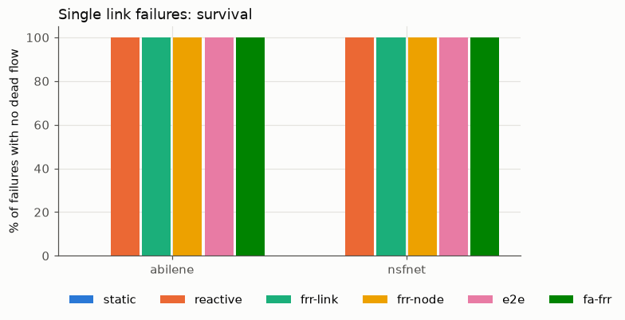
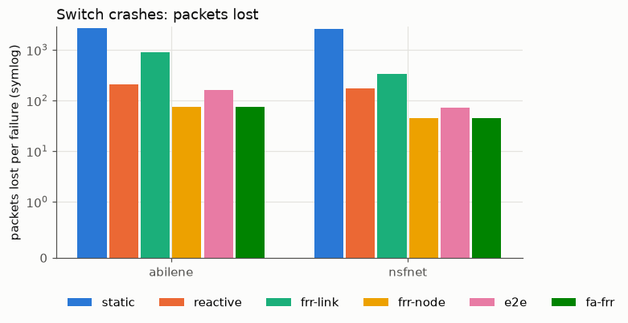
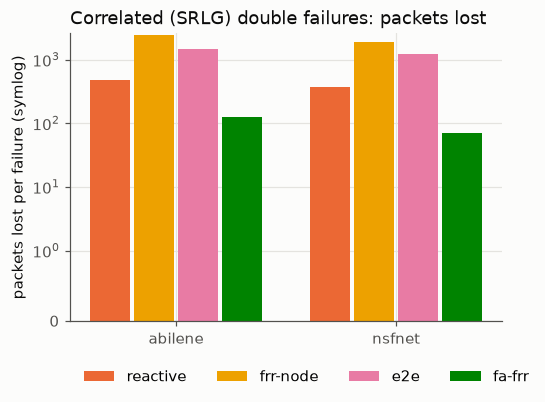
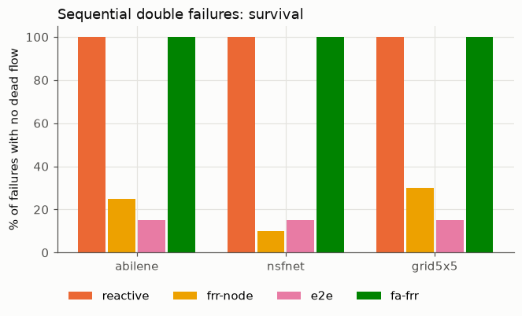
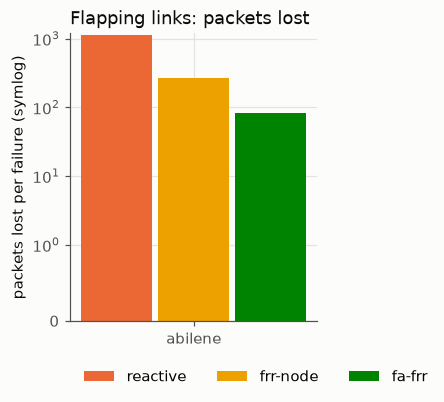
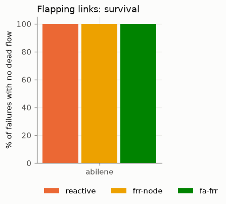
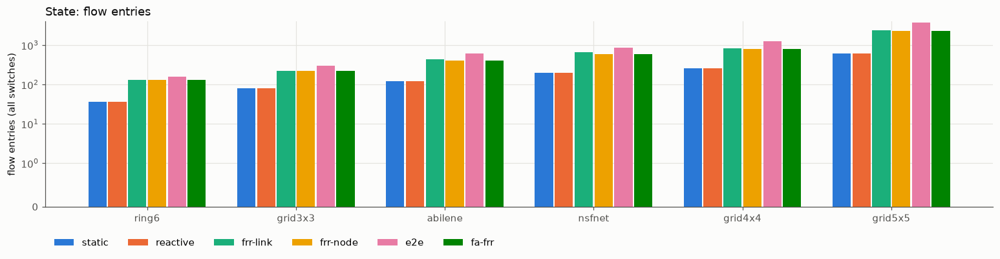

# Evaluation report

Generated by `python -m ffr experiment` in 2466 s. Traffic: all host pairs, constant bit rate; outage = longest run of consecutive lost packets. Raw data: the CSV files next to this report.

## What a failure looks like

One flow (SEA→ATL, 1000 pkt/s) crosses DEN–KSC, which is cut at 450 ms. Packets delivered per millisecond, per strategy.

| app | lost | outage_ms | hops_after |
|---|---|---|---|
| static | 262 | inf | 5 |
| reactive | 21 | 21.0 | 5 |
| frr-link | 5 | 5.0 | 6 |
| frr-node | 5 | 5.0 | 6 |
| e2e | 29 | 29.0 | 5 |
| fa-frr | 5 | 5.0 | 5 |

## Single link failures

Every link is cut once (LOS detection). How much traffic does each strategy lose, how long are outages, how good are paths afterwards and what does it cost?

| topo | app | runs | survival_pct | dead_flows | lost_pkts | mean_outage_ms | max_outage_ms | stretch | affected_flows | peak_flow_entries | looped_pkts | max_link_flows_before | max_link_flows_after |
|---|---|---|---|---|---|---|---|---|---|---|---|---|---|
| abilene | static | 14 | 0.0 | 19.71 | 3533.4 | n/a | n/a | 1.0 | 19.71 | 121 | 0.0 | 48.0 | 48.0 |
| abilene | reactive | 14 | 100.0 | 0.0 | 228.1 | 23.2 | 32.0 | 1.027 | 19.71 | 121 | 7.5 | 48.0 | 50.9 |
| abilene | frr-link | 14 | 100.0 | 0.0 | 54.5 | 5.93 | 12.0 | 1.162 | 19.71 | 440 | 0.0 | 48.0 | 51.6 |
| abilene | frr-node | 14 | 100.0 | 0.0 | 54.5 | 5.93 | 12.0 | 1.17 | 19.71 | 404 | 0.0 | 48.0 | 51.3 |
| abilene | e2e | 14 | 100.0 | 0.0 | 198.7 | 18.67 | 56.0 | 1.065 | 20.0 | 621 | 0.0 | 46.0 | 47.3 |
| abilene | fa-frr | 14 | 100.0 | 0.0 | 54.5 | 5.93 | 12.0 | 1.027 | 19.71 | 681 | 0.0 | 48.0 | 50.9 |
| nsfnet | static | 21 | 0.0 | 18.57 | 3281.7 | n/a | n/a | 1.0 | 18.57 | 196 | 0.0 | 28.0 | 28.0 |
| nsfnet | reactive | 21 | 100.0 | 0.0 | 197.7 | 21.18 | 26.0 | 1.0 | 18.57 | 196 | 2.0 | 28.0 | 34.3 |
| nsfnet | frr-link | 21 | 100.0 | 0.0 | 37.1 | 4.0 | 4.0 | 1.181 | 18.57 | 662 | 0.0 | 28.0 | 35.1 |
| nsfnet | frr-node | 21 | 100.0 | 0.0 | 37.1 | 4.0 | 4.0 | 1.19 | 18.57 | 593 | 0.0 | 28.0 | 35.4 |
| nsfnet | e2e | 21 | 100.0 | 0.0 | 98.7 | 10.35 | 20.0 | 1.018 | 18.57 | 880 | 0.0 | 28.0 | 35.5 |
| nsfnet | fa-frr | 21 | 100.0 | 0.0 | 37.1 | 4.0 | 4.0 | 1.0 | 18.57 | 1012 | 0.0 | 28.0 | 34.3 |
| grid5x5 | static | 20 | 0.0 | 53.4 | 9398.8 | n/a | n/a | 1.0 | 53.4 | 625 | 0.0 | 108.0 | 108.0 |
| grid5x5 | reactive | 20 | 100.0 | 0.0 | 560.5 | 20.66 | 36.0 | 1.0 | 53.4 | 625 | 5.35 | 108.0 | 120.2 |
| grid5x5 | frr-link | 20 | 100.0 | 0.0 | 53.4 | 2.0 | 2.0 | 1.144 | 53.4 | 2425 | 0.0 | 108.0 | 123.3 |
| grid5x5 | frr-node | 20 | 100.0 | 0.0 | 53.4 | 2.0 | 2.0 | 1.144 | 53.4 | 2325 | 0.0 | 108.0 | 123.3 |
| grid5x5 | e2e | 20 | 100.0 | 0.0 | 1314.7 | 17.64 | 56.0 | 1.0 | 146.85 | 3825 | 0.0 | 90.0 | 104.2 |
| grid5x5 | fa-frr | 20 | 100.0 | 0.0 | 53.4 | 2.0 | 2.0 | 1.0 | 53.4 | 4066 | 0.0 | 108.0 | 120.2 |

## Switch crashes

Each switch crashes once (flows to/from it are excluded). Link protection's detours may run through the crashed switch; node protection's may not.

| topo | app | runs | survival_pct | dead_flows | lost_pkts | mean_outage_ms | max_outage_ms | stretch | affected_flows | peak_flow_entries | looped_pkts | max_link_flows_before | max_link_flows_after |
|---|---|---|---|---|---|---|---|---|---|---|---|---|---|
| abilene | static | 11 | 9.1 | 15.09 | 2728.3 | 0.0 | 0.0 | 1.0 | 15.09 | 121 | 0.0 | 39.6 | 39.6 |
| abilene | reactive | 11 | 100.0 | 0.0 | 206.9 | 25.03 | 36.0 | 1.011 | 15.09 | 121 | 4.55 | 39.6 | 43.6 |
| abilene | frr-link | 11 | 54.5 | 4.73 | 906.5 | 9.68 | 18.0 | 1.039 | 15.09 | 440 | 0.0 | 39.6 | 39.8 |
| abilene | frr-node | 11 | 100.0 | 0.0 | 74.5 | 9.64 | 18.0 | 1.062 | 15.09 | 404 | 0.0 | 39.6 | 43.5 |
| abilene | e2e | 11 | 100.0 | 0.0 | 163.6 | 18.94 | 52.0 | 1.048 | 15.45 | 621 | 0.0 | 38.0 | 42.0 |
| abilene | fa-frr | 11 | 100.0 | 0.0 | 74.5 | 9.64 | 18.0 | 1.011 | 15.09 | 587 | 0.0 | 39.6 | 43.6 |
| nsfnet | static | 14 | 7.1 | 14.86 | 2634.6 | 0.0 | 0.0 | 1.0 | 14.86 | 196 | 0.0 | 26.7 | 26.7 |
| nsfnet | reactive | 14 | 100.0 | 0.0 | 171.3 | 21.2 | 28.0 | 1.0 | 14.86 | 196 | 0.71 | 26.7 | 32.1 |
| nsfnet | frr-link | 14 | 64.3 | 1.64 | 330.9 | 5.57 | 6.0 | 1.068 | 14.86 | 662 | 0.0 | 26.7 | 31.3 |
| nsfnet | frr-node | 14 | 100.0 | 0.0 | 44.6 | 5.57 | 6.0 | 1.072 | 14.86 | 593 | 0.0 | 26.7 | 32.3 |
| nsfnet | e2e | 14 | 100.0 | 0.0 | 71.4 | 8.51 | 18.0 | 1.008 | 14.86 | 880 | 0.0 | 27.1 | 33.1 |
| nsfnet | fa-frr | 14 | 100.0 | 0.0 | 44.6 | 5.57 | 6.0 | 1.0 | 14.86 | 947 | 0.0 | 26.7 | 32.1 |

## Gray (silent) failures

Links fail silently: the signal stays up but every packet is dropped. Which detection mechanisms notice, and how fast?

| config | runs | survival_pct | dead_flows | lost_pkts | mean_outage_ms | max_outage_ms | stretch | affected_flows | peak_flow_entries | looped_pkts | max_link_flows_before | max_link_flows_after |
|---|---|---|---|---|---|---|---|---|---|---|---|---|
| reactive + LLDP 50ms | 14 | 100.0 | 0.0 | 1647.6 | 167.2 | 176.0 | 1.027 | 19.71 | 121 | 7.5 | 48.0 | 50.9 |
| frr-node + LOS | 14 | 0.0 | 19.71 | 5504.8 | n/a | n/a | 1.0 | 19.71 | 404 | 0.0 | 48.0 | 48.0 |
| frr-node + BFD | 14 | 100.0 | 0.0 | 130.8 | 13.49 | 20.0 | 1.17 | 19.71 | 404 | 0.0 | 48.0 | 51.3 |
| e2e (path BFD) | 14 | 100.0 | 0.0 | 226.6 | 21.97 | 56.0 | 1.065 | 20.0 | 621 | 0.0 | 46.0 | 47.3 |
| fa-frr + BFD | 14 | 100.0 | 0.0 | 130.8 | 13.49 | 20.0 | 1.027 | 19.71 | 681 | 0.0 | 48.0 | 50.9 |

## BFD interval trade-off

Gray failures detected by BFD (detect multiplier 3). Shorter intervals detect faster but send more hello packets.

| bfd_interval_ms | detect_time_ms | mean_outage_ms | lost_pkts | bfd_pkts_per_s_per_link | bfd_pkts_per_s_network |
|---|---|---|---|---|---|
| 1 | 3 | 7.7 | 63.5 | 2000 | 28000 |
| 2 | 6 | 10.01 | 83.9 | 1000 | 14000 |
| 3.3 | 9.9 | 13.4 | 116.6 | 606 | 8485 |
| 5 | 15 | 17.47 | 148.8 | 400 | 5600 |
| 10 | 30 | 29.55 | 257.6 | 200 | 2800 |
| 20 | 60 | 53.93 | 463.5 | 100 | 1400 |
| 50 | 150 | 130.16 | 1132.9 | 40 | 560 |

## Correlated (SRLG) double failures

Two links that share a risk group (declared in the topology) fail at the same instant. Incident pairs meet at a switch; remote pairs share no switch.

| topo | kind | app | runs | survival_pct | dead_flows | lost_pkts | mean_outage_ms | max_outage_ms | stretch | affected_flows | peak_flow_entries | looped_pkts | max_link_flows_before | max_link_flows_after |
|---|---|---|---|---|---|---|---|---|---|---|---|---|---|---|
| abilene | incident | reactive | 15 | 100.0 | 0.0 | 483.2 | 24.83 | 36.0 | 1.006 | 39.2 | 121 | 28.2 | 48.0 | 55.6 |
| abilene | incident | frr-node | 15 | 33.3 | 13.27 | 2471.2 | 7.11 | 18.0 | 1.14 | 39.2 | 404 | 0.0 | 48.0 | 49.7 |
| abilene | incident | frr-srlg | 15 | 100.0 | 0.0 | 125.1 | 6.71 | 18.0 | 1.199 | 39.2 | 418 | 0.0 | 48.0 | 58.0 |
| abilene | incident | e2e | 15 | 33.3 | 6.67 | 1497.0 | 19.97 | 52.0 | 1.041 | 37.07 | 621 | 0.0 | 46.0 | 50.1 |
| abilene | incident | e2e-srlg | 15 | 100.0 | 0.0 | 350.9 | 18.99 | 58.0 | 1.037 | 36.4 | 634 | 0.0 | 45.3 | 55.2 |
| abilene | incident | fa-frr | 15 | 100.0 | 0.0 | 125.1 | 6.71 | 18.0 | 1.006 | 39.2 | 618 | 0.0 | 48.0 | 55.6 |
| abilene | incident | fa-frr-nosrlg | 15 | 100.0 | 0.0 | 707.8 | 33.78 | 130.0 | 1.006 | 39.2 | 605 | 0.0 | 48.0 | 55.6 |
| abilene | remote | reactive | 15 | 100.0 | 0.0 | 450.3 | 24.21 | 46.0 | 1.012 | 37.33 | 121 | 10.87 | 48.0 | 52.9 |
| abilene | remote | frr-node | 15 | 13.3 | 6.6 | 1273.8 | 6.03 | 12.0 | 1.131 | 37.33 | 404 | 0.0 | 48.0 | 50.9 |
| abilene | remote | frr-srlg | 15 | 100.0 | 0.0 | 112.5 | 6.09 | 12.0 | 1.144 | 37.33 | 409 | 0.0 | 48.0 | 54.4 |
| abilene | remote | e2e | 15 | 20.0 | 11.2 | 2249.3 | 17.54 | 50.0 | 1.041 | 37.87 | 621 | 0.0 | 46.0 | 45.9 |
| abilene | remote | e2e-srlg | 15 | 53.3 | 8.27 | 1746.7 | 17.54 | 52.0 | 1.053 | 37.33 | 625 | 0.0 | 45.9 | 48.1 |
| abilene | remote | fa-frr | 15 | 100.0 | 0.0 | 112.5 | 6.09 | 12.0 | 1.012 | 37.33 | 638 | 0.0 | 48.0 | 52.9 |
| abilene | remote | fa-frr-nosrlg | 15 | 100.0 | 0.0 | 394.6 | 18.72 | 132.0 | 1.012 | 37.33 | 633 | 0.0 | 48.0 | 52.9 |
| nsfnet | incident | reactive | 15 | 100.0 | 0.0 | 371.3 | 22.22 | 28.0 | 1.0 | 33.33 | 196 | 3.33 | 28.0 | 39.5 |
| nsfnet | incident | frr-node | 15 | 6.7 | 10.4 | 1890.1 | 4.42 | 6.0 | 1.118 | 33.33 | 593 | 0.0 | 28.0 | 35.9 |
| nsfnet | incident | frr-srlg | 15 | 100.0 | 0.0 | 71.7 | 4.29 | 6.0 | 1.189 | 33.33 | 598 | 0.0 | 28.0 | 41.3 |
| nsfnet | incident | e2e | 15 | 0.0 | 6.13 | 1225.7 | 10.93 | 20.0 | 1.021 | 33.47 | 880 | 0.0 | 28.0 | 38.9 |
| nsfnet | incident | e2e-srlg | 15 | 100.0 | 0.0 | 166.7 | 9.99 | 20.0 | 1.021 | 33.07 | 885 | 0.0 | 28.1 | 41.4 |
| nsfnet | incident | fa-frr | 15 | 100.0 | 0.0 | 71.7 | 4.29 | 6.0 | 1.0 | 33.33 | 1014 | 0.0 | 28.0 | 39.5 |
| nsfnet | incident | fa-frr-nosrlg | 15 | 100.0 | 0.0 | 552.5 | 32.96 | 122.0 | 1.0 | 33.33 | 1009 | 0.0 | 28.0 | 39.5 |
| nsfnet | remote | reactive | 15 | 100.0 | 0.0 | 406.4 | 21.58 | 30.0 | 1.0 | 37.53 | 196 | 4.07 | 28.0 | 41.0 |
| nsfnet | remote | frr-node | 15 | 26.7 | 4.6 | 879.5 | 4.06 | 8.0 | 1.191 | 37.53 | 593 | 0.0 | 28.0 | 40.1 |
| nsfnet | remote | frr-srlg | 15 | 100.0 | 0.0 | 76.1 | 4.05 | 8.0 | 1.195 | 37.53 | 595 | 0.0 | 28.0 | 41.5 |
| nsfnet | remote | e2e | 15 | 13.3 | 6.47 | 1303.5 | 10.35 | 20.0 | 1.014 | 37.33 | 880 | 0.0 | 28.0 | 39.3 |
| nsfnet | remote | e2e-srlg | 15 | 100.0 | 0.0 | 196.9 | 10.52 | 20.0 | 1.017 | 37.13 | 882 | 0.0 | 28.2 | 42.7 |
| nsfnet | remote | fa-frr | 15 | 100.0 | 0.0 | 76.1 | 4.05 | 8.0 | 1.0 | 37.53 | 1050 | 0.0 | 28.0 | 41.0 |
| nsfnet | remote | fa-frr-nosrlg | 15 | 100.0 | 0.0 | 317.4 | 16.23 | 144.0 | 1.0 | 37.53 | 1048 | 0.0 | 28.0 | 41.0 |
| grid5x5 | incident | reactive | 15 | 100.0 | 0.0 | 1002.5 | 22.09 | 38.0 | 1.0 | 89.07 | 625 | 13.47 | 108.0 | 134.3 |
| grid5x5 | incident | frr-node | 15 | 20.0 | 31.4 | 5595.6 | 2.22 | 4.0 | 1.116 | 89.07 | 2325 | 0.0 | 108.0 | 115.6 |
| grid5x5 | incident | frr-srlg | 15 | 100.0 | 0.0 | 95.3 | 2.18 | 4.0 | 1.175 | 89.07 | 2339 | 0.0 | 108.0 | 132.5 |
| grid5x5 | incident | e2e | 15 | 20.0 | 11.47 | 3479.8 | 16.77 | 56.0 | 1.0 | 178.87 | 3825 | 0.0 | 90.0 | 101.3 |
| grid5x5 | incident | e2e-srlg | 15 | 100.0 | 0.0 | 1537.1 | 16.64 | 74.0 | 1.0 | 180.2 | 3843 | 0.0 | 90.5 | 108.7 |
| grid5x5 | incident | fa-frr | 15 | 100.0 | 0.0 | 95.3 | 2.18 | 4.0 | 1.0 | 89.07 | 4096 | 0.0 | 108.0 | 134.3 |
| grid5x5 | incident | fa-frr-nosrlg | 15 | 100.0 | 0.0 | 3403.8 | 67.87 | 262.0 | 1.0 | 89.07 | 4082 | 0.0 | 108.0 | 134.3 |
| grid5x5 | remote | reactive | 15 | 100.0 | 0.0 | 938.0 | 21.12 | 42.0 | 1.0 | 88.67 | 625 | 12.0 | 108.0 | 113.6 |
| grid5x5 | remote | frr-node | 15 | 66.7 | 6.73 | 1268.1 | 2.0 | 2.0 | 1.137 | 88.67 | 2325 | 0.0 | 108.0 | 114.8 |
| grid5x5 | remote | frr-srlg | 15 | 100.0 | 0.0 | 89.1 | 2.0 | 2.0 | 1.152 | 88.67 | 2329 | 0.0 | 108.0 | 115.8 |
| grid5x5 | remote | e2e | 15 | 13.3 | 10.0 | 3181.7 | 16.6 | 56.0 | 1.0 | 175.07 | 3825 | 0.0 | 90.0 | 106.1 |
| grid5x5 | remote | e2e-srlg | 15 | 93.3 | 0.13 | 1561.2 | 16.93 | 68.0 | 1.004 | 176.0 | 3833 | 0.0 | 91.7 | 108.1 |
| grid5x5 | remote | fa-frr | 15 | 100.0 | 0.0 | 89.1 | 2.0 | 2.0 | 1.0 | 88.67 | 4058 | 0.0 | 108.0 | 113.6 |
| grid5x5 | remote | fa-frr-nosrlg | 15 | 100.0 | 0.0 | 801.1 | 19.18 | 248.0 | 1.0 | 88.67 | 4053 | 0.0 | 108.0 | 113.6 |

## Sequential double failures

A second, independent link fails 200 ms after the first. Is the network still protected after the first failure?

| topo | app | runs | survival_pct | dead_flows | lost_pkts | mean_outage_ms | max_outage_ms | stretch | affected_flows | peak_flow_entries | looped_pkts | max_link_flows_before | max_link_flows_after |
|---|---|---|---|---|---|---|---|---|---|---|---|---|---|
| abilene | reactive | 20 | 100.0 | 0.0 | 418.7 | 23.4 | 32.0 | 1.015 | 31.7 | 121 | 14.15 | 48.0 | 53.0 |
| abilene | frr-node | 20 | 25.0 | 6.3 | 1225.0 | 5.86 | 12.0 | 1.153 | 31.7 | 404 | 0.0 | 48.0 | 51.3 |
| abilene | e2e | 20 | 15.0 | 9.7 | 2006.7 | 17.81 | 56.0 | 1.043 | 32.6 | 621 | 0.0 | 46.0 | 45.9 |
| abilene | fa-frr | 20 | 100.0 | 0.0 | 102.0 | 5.98 | 12.0 | 1.015 | 31.7 | 684 | 0.0 | 48.0 | 53.0 |
| abilene | fa-frr-noreopt | 20 | 25.0 | 6.3 | 1225.0 | 5.86 | 12.0 | 1.153 | 31.7 | 404 | 0.0 | 48.0 | 51.3 |
| nsfnet | reactive | 20 | 100.0 | 0.0 | 431.6 | 21.37 | 28.0 | 1.0 | 36.95 | 196 | 4.35 | 28.0 | 43.5 |
| nsfnet | frr-node | 20 | 10.0 | 8.25 | 1533.1 | 4.02 | 10.0 | 1.17 | 36.95 | 593 | 0.0 | 28.0 | 41.5 |
| nsfnet | e2e | 20 | 15.0 | 7.5 | 1504.8 | 10.85 | 20.0 | 1.015 | 37.05 | 880 | 0.0 | 28.0 | 40.0 |
| nsfnet | fa-frr | 20 | 100.0 | 0.0 | 80.7 | 4.0 | 4.0 | 1.0 | 36.95 | 1060 | 0.0 | 28.0 | 43.5 |
| nsfnet | fa-frr-noreopt | 20 | 10.0 | 8.25 | 1533.1 | 4.02 | 10.0 | 1.17 | 36.95 | 593 | 0.0 | 28.0 | 41.5 |
| grid5x5 | reactive | 20 | 100.0 | 0.0 | 1053.0 | 21.15 | 36.0 | 1.0 | 95.8 | 625 | 9.4 | 108.0 | 124.6 |
| grid5x5 | frr-node | 20 | 30.0 | 9.45 | 1758.4 | 2.0 | 2.0 | 1.15 | 95.8 | 2325 | 0.0 | 108.0 | 126.2 |
| grid5x5 | e2e | 20 | 15.0 | 14.2 | 3993.3 | 16.43 | 56.0 | 1.0 | 182.5 | 3825 | 0.0 | 90.0 | 108.5 |
| grid5x5 | fa-frr | 20 | 100.0 | 0.0 | 233.2 | 5.41 | 218.0 | 1.0 | 95.8 | 5788 | 0.0 | 108.0 | 124.6 |
| grid5x5 | fa-frr-noreopt | 20 | 30.0 | 9.45 | 1758.4 | 2.0 | 2.0 | 1.15 | 95.8 | 2325 | 0.0 | 108.0 | 126.2 |

## Flapping links

A link goes down for 40 ms and up for 40 ms, five times in a row.

| topo | app | runs | survival_pct | dead_flows | lost_pkts | mean_outage_ms | max_outage_ms | stretch | affected_flows | peak_flow_entries | looped_pkts | max_link_flows_before | max_link_flows_after |
|---|---|---|---|---|---|---|---|---|---|---|---|---|---|
| abilene | reactive | 14 | 100.0 | 0.0 | 1142.4 | 23.21 | 32.0 | 1.028 | 19.71 | 121 | 96.07 | 48.0 | 48.0 |
| abilene | frr-node | 14 | 100.0 | 0.0 | 272.5 | 5.93 | 12.0 | 1.028 | 19.71 | 404 | 0.0 | 48.0 | 48.0 |
| abilene | fa-frr | 14 | 100.0 | 0.0 | 54.5 | 5.93 | 12.0 | 1.412 | 19.71 | 681 | 0.0 | 48.0 | 50.9 |
| abilene | fa-frr-nopin | 14 | 100.0 | 0.0 | 91.5 | 5.93 | 12.0 | 1.412 | 19.71 | 681 | 0.0 | 48.0 | 50.9 |
| abilene | fa-frr-fixedhold | 14 | 100.0 | 0.0 | 54.5 | 5.93 | 12.0 | 1.412 | 19.71 | 702 | 0.0 | 48.0 | 50.9 |
| abilene | fa-frr-nohold | 14 | 100.0 | 0.0 | 54.5 | 5.93 | 12.0 | 1.426 | 19.71 | 3260 | 0.0 | 48.0 | 51.0 |

## Flapping links over several seconds

A link flaps five times, then stays up; traffic runs 1.5 s past the last flap so that hold-downs expire. Fixed hold-down uses 200 ms after every flap; adaptive grows with the link's recent instability.

| pattern | app | runs | survival_pct | lost_pkts | mean_outage_ms | max_outage_ms | stretch | looped_pkts | peak_flow_entries |
|---|---|---|---|---|---|---|---|---|---|
| fast (40/40 ms) | reactive | 14 | 100.0 | 1142.4 | 23.21 | 32.0 | 1.028 | 96.07 | 121 |
| fast (40/40 ms) | frr-node | 14 | 100.0 | 272.5 | 5.93 | 12.0 | 1.028 | 0.0 | 404 |
| fast (40/40 ms) | fa-frr | 14 | 100.0 | 54.5 | 5.93 | 12.0 | 1.412 | 0.0 | 702 |
| fast (40/40 ms) | fa-frr-nopin | 14 | 100.0 | 91.5 | 5.93 | 12.0 | 1.412 | 0.0 | 702 |
| fast (40/40 ms) | fa-frr-fixedhold | 14 | 100.0 | 54.5 | 5.93 | 12.0 | 1.412 | 0.0 | 702 |
| fast (40/40 ms) | fa-frr-nohold | 14 | 100.0 | 54.5 | 5.93 | 12.0 | 1.412 | 0.0 | 3260 |
| fast (40/40 ms) | fa-frr-lam0 | 14 | 100.0 | 54.5 | 5.93 | 12.0 | 1.028 | 0.0 | 681 |
| slow (40/300 ms) | reactive | 14 | 100.0 | 1140.7 | 23.2 | 32.0 | 1.028 | 96.07 | 121 |
| slow (40/300 ms) | frr-node | 14 | 100.0 | 272.5 | 5.93 | 12.0 | 1.028 | 0.0 | 404 |
| slow (40/300 ms) | fa-frr | 14 | 100.0 | 54.5 | 5.93 | 12.0 | 1.412 | 0.0 | 702 |
| slow (40/300 ms) | fa-frr-nopin | 14 | 100.0 | 54.5 | 5.93 | 12.0 | 1.412 | 0.0 | 702 |
| slow (40/300 ms) | fa-frr-fixedhold | 14 | 100.0 | 65.1 | 5.94 | 12.0 | 1.412 | 0.0 | 974 |
| slow (40/300 ms) | fa-frr-nohold | 14 | 100.0 | 63.9 | 5.93 | 12.0 | 1.412 | 0.0 | 1001 |
| slow (40/300 ms) | fa-frr-lam0 | 14 | 100.0 | 54.5 | 5.93 | 12.0 | 1.028 | 0.0 | 681 |

## Time between two failures

A second, independent link fails 10-500 ms after the first (first failure at 1 s, traffic 0.8-2.5 s). fa-frr-slowrules installs each rule in 5 ms instead of 1 ms.

| topo | app | gap_ms | runs | survival_pct | dead_flows | lost_pkts | mean_outage_ms |
|---|---|---|---|---|---|---|---|
| abilene | frr-node | 10 | 10 | 20.0 | 3.9 | 3008.8 | 5.91 |
| abilene | fa-frr | 10 | 10 | 100.0 | 0.0 | 331.9 | 18.39 |
| abilene | fa-frr-unordered | 10 | 10 | 100.0 | 0.0 | 308.3 | 17.28 |
| abilene | fa-frr-slowrules | 10 | 10 | 100.0 | 0.0 | 1082.9 | 57.38 |
| abilene | frr-node | 20 | 10 | 20.0 | 3.9 | 2995.9 | 5.91 |
| abilene | fa-frr | 20 | 10 | 100.0 | 0.0 | 319.0 | 17.66 |
| abilene | fa-frr-unordered | 20 | 10 | 100.0 | 0.0 | 295.4 | 16.55 |
| abilene | fa-frr-slowrules | 20 | 10 | 100.0 | 0.0 | 1070.0 | 56.66 |
| abilene | frr-node | 40 | 10 | 20.0 | 3.9 | 2957.8 | 5.91 |
| abilene | fa-frr | 40 | 10 | 100.0 | 0.0 | 280.9 | 15.63 |
| abilene | fa-frr-unordered | 40 | 10 | 100.0 | 0.0 | 257.3 | 14.52 |
| abilene | fa-frr-slowrules | 40 | 10 | 100.0 | 0.0 | 1031.9 | 54.62 |
| abilene | frr-node | 60 | 10 | 20.0 | 3.9 | 2918.8 | 5.91 |
| abilene | fa-frr | 60 | 10 | 100.0 | 0.0 | 173.5 | 10.33 |
| abilene | fa-frr-unordered | 60 | 10 | 100.0 | 0.0 | 159.6 | 9.57 |
| abilene | fa-frr-slowrules | 60 | 10 | 100.0 | 0.0 | 992.9 | 52.62 |
| abilene | frr-node | 80 | 10 | 20.0 | 3.9 | 2879.8 | 5.91 |
| abilene | fa-frr | 80 | 10 | 100.0 | 0.0 | 113.4 | 7.02 |
| abilene | fa-frr-unordered | 80 | 10 | 100.0 | 0.0 | 109.8 | 6.83 |
| abilene | fa-frr-slowrules | 80 | 10 | 100.0 | 0.0 | 953.9 | 50.61 |
| abilene | frr-node | 100 | 10 | 20.0 | 3.9 | 2840.8 | 5.91 |
| abilene | fa-frr | 100 | 10 | 100.0 | 0.0 | 98.8 | 6.19 |
| abilene | fa-frr-unordered | 100 | 10 | 100.0 | 0.0 | 97.9 | 6.16 |
| abilene | fa-frr-slowrules | 100 | 10 | 100.0 | 0.0 | 914.9 | 48.61 |
| abilene | frr-node | 120 | 10 | 20.0 | 3.9 | 2801.8 | 5.91 |
| abilene | fa-frr | 120 | 10 | 100.0 | 0.0 | 96.5 | 6.07 |
| abilene | fa-frr-unordered | 120 | 10 | 100.0 | 0.0 | 96.5 | 6.07 |
| abilene | fa-frr-slowrules | 120 | 10 | 100.0 | 0.0 | 875.9 | 46.6 |
| abilene | frr-node | 150 | 10 | 20.0 | 3.9 | 2743.3 | 5.91 |
| abilene | fa-frr | 150 | 10 | 100.0 | 0.0 | 96.5 | 6.07 |
| abilene | fa-frr-unordered | 150 | 10 | 100.0 | 0.0 | 96.5 | 6.07 |
| abilene | fa-frr-slowrules | 150 | 10 | 100.0 | 0.0 | 817.4 | 43.6 |
| abilene | frr-node | 200 | 10 | 20.0 | 3.9 | 2645.8 | 5.91 |
| abilene | fa-frr | 200 | 10 | 100.0 | 0.0 | 96.5 | 6.07 |
| abilene | fa-frr-unordered | 200 | 10 | 100.0 | 0.0 | 96.5 | 6.07 |
| abilene | fa-frr-slowrules | 200 | 10 | 100.0 | 0.0 | 719.9 | 38.58 |
| abilene | frr-node | 300 | 10 | 20.0 | 3.9 | 2450.8 | 5.91 |
| abilene | fa-frr | 300 | 10 | 100.0 | 0.0 | 96.5 | 6.07 |
| abilene | fa-frr-unordered | 300 | 10 | 100.0 | 0.0 | 96.5 | 6.07 |
| abilene | fa-frr-slowrules | 300 | 10 | 100.0 | 0.0 | 222.8 | 13.65 |
| abilene | frr-node | 400 | 10 | 20.0 | 3.9 | 2255.8 | 5.91 |
| abilene | fa-frr | 400 | 10 | 100.0 | 0.0 | 96.5 | 6.07 |
| abilene | fa-frr-unordered | 400 | 10 | 100.0 | 0.0 | 96.5 | 6.07 |
| abilene | fa-frr-slowrules | 400 | 10 | 100.0 | 0.0 | 97.0 | 6.12 |
| abilene | frr-node | 500 | 10 | 20.0 | 3.9 | 2060.8 | 5.91 |
| abilene | fa-frr | 500 | 10 | 100.0 | 0.0 | 96.5 | 6.07 |
| abilene | fa-frr-unordered | 500 | 10 | 100.0 | 0.0 | 96.5 | 6.07 |
| abilene | fa-frr-slowrules | 500 | 10 | 100.0 | 0.0 | 96.5 | 6.07 |
| nsfnet | frr-node | 10 | 10 | 10.0 | 9.2 | 6945.5 | 4.04 |
| nsfnet | fa-frr | 10 | 10 | 100.0 | 0.0 | 716.8 | 35.09 |
| nsfnet | fa-frr-unordered | 10 | 10 | 100.0 | 0.0 | 675.2 | 33.09 |
| nsfnet | fa-frr-slowrules | 10 | 10 | 100.0 | 0.0 | 2833.6 | 138.76 |
| nsfnet | frr-node | 20 | 10 | 10.0 | 9.2 | 6899.5 | 4.04 |
| nsfnet | fa-frr | 20 | 10 | 100.0 | 0.0 | 670.8 | 32.72 |
| nsfnet | fa-frr-unordered | 20 | 10 | 100.0 | 0.0 | 629.2 | 30.73 |
| nsfnet | fa-frr-slowrules | 20 | 10 | 100.0 | 0.0 | 2787.6 | 136.4 |
| nsfnet | frr-node | 40 | 10 | 10.0 | 9.2 | 6807.5 | 4.04 |
| nsfnet | fa-frr | 40 | 10 | 100.0 | 0.0 | 578.8 | 28.22 |
| nsfnet | fa-frr-unordered | 40 | 10 | 100.0 | 0.0 | 537.2 | 26.23 |
| nsfnet | fa-frr-slowrules | 40 | 10 | 100.0 | 0.0 | 2695.6 | 131.9 |
| nsfnet | frr-node | 60 | 10 | 10.0 | 9.2 | 6715.5 | 4.04 |
| nsfnet | fa-frr | 60 | 10 | 100.0 | 0.0 | 317.5 | 15.17 |
| nsfnet | fa-frr-unordered | 60 | 10 | 100.0 | 0.0 | 246.8 | 11.85 |
| nsfnet | fa-frr-slowrules | 60 | 10 | 100.0 | 0.0 | 2603.6 | 127.4 |
| nsfnet | frr-node | 80 | 10 | 10.0 | 9.2 | 6623.5 | 4.04 |
| nsfnet | fa-frr | 80 | 10 | 100.0 | 0.0 | 167.6 | 7.97 |
| nsfnet | fa-frr-unordered | 80 | 10 | 100.0 | 0.0 | 101.4 | 4.94 |
| nsfnet | fa-frr-slowrules | 80 | 10 | 100.0 | 0.0 | 2511.6 | 122.89 |
| nsfnet | frr-node | 100 | 10 | 10.0 | 9.2 | 6531.5 | 4.04 |
| nsfnet | fa-frr | 100 | 10 | 100.0 | 0.0 | 84.6 | 4.2 |
| nsfnet | fa-frr-unordered | 100 | 10 | 100.0 | 0.0 | 79.8 | 4.0 |
| nsfnet | fa-frr-slowrules | 100 | 10 | 100.0 | 0.0 | 2419.6 | 118.39 |
| nsfnet | frr-node | 120 | 10 | 10.0 | 9.2 | 6439.5 | 4.04 |
| nsfnet | fa-frr | 120 | 10 | 100.0 | 0.0 | 79.8 | 4.0 |
| nsfnet | fa-frr-unordered | 120 | 10 | 100.0 | 0.0 | 79.8 | 4.0 |
| nsfnet | fa-frr-slowrules | 120 | 10 | 100.0 | 0.0 | 2327.6 | 113.89 |
| nsfnet | frr-node | 150 | 10 | 10.0 | 9.2 | 6301.5 | 4.04 |
| nsfnet | fa-frr | 150 | 10 | 100.0 | 0.0 | 79.8 | 4.0 |
| nsfnet | fa-frr-unordered | 150 | 10 | 100.0 | 0.0 | 79.8 | 4.0 |
| nsfnet | fa-frr-slowrules | 150 | 10 | 100.0 | 0.0 | 2189.6 | 107.14 |
| nsfnet | frr-node | 200 | 10 | 10.0 | 9.2 | 6071.5 | 4.04 |
| nsfnet | fa-frr | 200 | 10 | 100.0 | 0.0 | 79.8 | 4.0 |
| nsfnet | fa-frr-unordered | 200 | 10 | 100.0 | 0.0 | 79.8 | 4.0 |
| nsfnet | fa-frr-slowrules | 200 | 10 | 100.0 | 0.0 | 1959.6 | 95.88 |
| nsfnet | frr-node | 300 | 10 | 10.0 | 9.2 | 5611.5 | 4.04 |
| nsfnet | fa-frr | 300 | 10 | 100.0 | 0.0 | 79.8 | 4.0 |
| nsfnet | fa-frr-unordered | 300 | 10 | 100.0 | 0.0 | 79.8 | 4.0 |
| nsfnet | fa-frr-slowrules | 300 | 10 | 100.0 | 0.0 | 448.5 | 21.3 |
| nsfnet | frr-node | 400 | 10 | 10.0 | 9.2 | 5151.5 | 4.04 |
| nsfnet | fa-frr | 400 | 10 | 100.0 | 0.0 | 79.8 | 4.0 |
| nsfnet | fa-frr-unordered | 400 | 10 | 100.0 | 0.0 | 79.8 | 4.0 |
| nsfnet | fa-frr-slowrules | 400 | 10 | 100.0 | 0.0 | 79.8 | 4.0 |
| nsfnet | frr-node | 500 | 10 | 10.0 | 9.2 | 4691.5 | 4.04 |
| nsfnet | fa-frr | 500 | 10 | 100.0 | 0.0 | 79.8 | 4.0 |
| nsfnet | fa-frr-unordered | 500 | 10 | 100.0 | 0.0 | 79.8 | 4.0 |
| nsfnet | fa-frr-slowrules | 500 | 10 | 100.0 | 0.0 | 79.8 | 4.0 |

## Transient loops during updates

Every link of four topologies is cut (and, separately, cut and restored 200 ms later, hold-down 50 ms); the controller channel has no jitter or up to 20 ms. A packet that visits a switch twice with the same tag is counted as looped.

| jitter_ms | app | runs | runs_with_loops | looped_pkts | lost_pkts |
|---|---|---|---|---|---|
| 0 | reactive | 106 | 78 | 680 | 18406 |
| 0 | fa-frr-unordered | 106 | 79 | 532 | 3482 |
| 0 | fa-frr | 106 | 0 | 0 | 3482 |
| 20 | reactive | 106 | 68 | 1978 | 28738 |
| 20 | fa-frr-unordered | 106 | 70 | 999 | 3482 |
| 20 | fa-frr | 106 | 0 | 0 | 3482 |

## Correlated follow-up failures

A link fails; 200 ms later the other link of its declared SRLG fails too. The first failure raises the peer's failure probability (rho*delta), so risk-aware re-optimisation (lam>0) moves primaries off the peer before it fails.

| topo | app | runs | survival_pct | affected_flows | flows_hit_last | pkts_lost_last | lost_pkts | mean_outage_ms | stretch |
|---|---|---|---|---|---|---|---|---|---|
| abilene | frr-srlg | 15 | 100.0 | 39.2 | 20.27 | 51.5 | 117.1 | 5.8 | 1.199 |
| abilene | fa-frr-lam0 | 15 | 100.0 | 39.2 | 25.2 | 64.8 | 130.3 | 5.73 | 1.006 |
| abilene | fa-frr | 15 | 100.0 | 33.6 | 13.47 | 34.5 | 100.1 | 5.64 | 1.007 |
| abilene | fa-frr-lam20 | 15 | 100.0 | 26.53 | 3.2 | 6.8 | 72.3 | 5.62 | 1.01 |
| nsfnet | frr-srlg | 15 | 100.0 | 33.33 | 17.4 | 34.8 | 71.9 | 4.0 | 1.189 |
| nsfnet | fa-frr-lam0 | 15 | 100.0 | 33.33 | 19.27 | 38.5 | 75.6 | 4.0 | 1.0 |
| nsfnet | fa-frr | 15 | 100.0 | 30.47 | 14.67 | 29.3 | 66.4 | 4.0 | 1.0 |
| nsfnet | fa-frr-lam20 | 15 | 100.0 | 19.47 | 0.93 | 1.9 | 38.9 | 4.0 | 1.0 |

## Risk-aware primaries under failures drawn from the priors

Heterogeneous priors (0.5-15 %, seed 5); 30 link failures per topology drawn with probability proportional to the prior (seed 13). lam=0 routes on delay only.

| topo | app | runs | survival_pct | affected_flows | lost_pkts | mean_outage_ms | mean_path_delay_ms | stretch |
|---|---|---|---|---|---|---|---|---|
| abilene | fa-frr-lam0 | 30 | 100.0 | 25.2 | 66.9 | 5.63 | 11.533 | 1.01 |
| abilene | fa-frr | 30 | 100.0 | 21.4 | 59.3 | 5.71 | 11.702 | 1.011 |
| abilene | fa-frr-lam20 | 30 | 100.0 | 19.6 | 54.1 | 4.32 | 12.964 | 1.187 |
| nsfnet | fa-frr-lam0 | 30 | 100.0 | 22.5 | 45.0 | 4.0 | 4.306 | 1.0 |
| nsfnet | fa-frr | 30 | 100.0 | 20.67 | 41.3 | 4.0 | 4.328 | 1.011 |
| nsfnet | fa-frr-lam20 | 30 | 100.0 | 17.67 | 35.3 | 4.0 | 4.723 | 1.128 |

## Re-protection time and rule installation time

One link is cut; time from the cut until every group of the new generation is installed, for 1-33 ms per rule (hardware switches take 2.5-33 ms), with and without the OpenFlow 1.3 OFPP_IN_PORT groups and rules. Planning wall-clock time (all destinations, this machine, Python): {'abilene': 1.8, 'nsfnet': 3.6, 'grid5x5': 22.1}.

| topo | rule_ms | of13_inport | runs | initial_install_ms_max | reprotect_ms_mean | reprotect_ms_max | ctrl_msgs | flow_entries | groups |
|---|---|---|---|---|---|---|---|---|---|
| abilene | 1 | False | 14 | 80.0 | 101.14 | 124.0 | 966 | 398 | 110 |
| abilene | 1 | True | 14 | 100.0 | 124.36 | 156.0 | 1396 | 490 | 203 |
| abilene | 2.5 | False | 14 | 170.0 | 190.29 | 233.5 | 966 | 398 | 110 |
| abilene | 2.5 | True | 14 | 220.0 | 248.32 | 313.5 | 1396 | 490 | 203 |
| abilene | 5 | False | 14 | 320.0 | 338.86 | 426.0 | 966 | 398 | 110 |
| abilene | 5 | True | 14 | 420.0 | 454.93 | 576.0 | 1396 | 490 | 203 |
| abilene | 10 | False | 14 | 620.0 | 636.0 | 811.0 | 966 | 398 | 110 |
| abilene | 10 | True | 14 | 820.0 | 868.14 | 1101.0 | 1396 | 490 | 203 |
| abilene | 33 | False | 14 | 2000.0 | 2002.86 | 2582.0 | 966 | 398 | 110 |
| abilene | 33 | True | 14 | 2660.0 | 2768.93 | 3539.0 | 1396 | 490 | 203 |
| nsfnet | 1 | False | 21 | 89.0 | 105.81 | 125.0 | 1457 | 615 | 182 |
| nsfnet | 1 | True | 21 | 115.0 | 138.43 | 169.0 | 2156 | 794 | 361 |
| nsfnet | 2.5 | False | 21 | 192.5 | 203.74 | 236.0 | 1457 | 615 | 182 |
| nsfnet | 2.5 | True | 21 | 257.5 | 285.4 | 346.0 | 2156 | 794 | 361 |
| nsfnet | 5 | False | 21 | 365.0 | 366.95 | 421.0 | 1457 | 615 | 182 |
| nsfnet | 5 | True | 21 | 495.0 | 530.52 | 641.0 | 2156 | 794 | 361 |
| nsfnet | 10 | False | 21 | 710.0 | 693.38 | 791.0 | 1457 | 615 | 182 |
| nsfnet | 10 | True | 21 | 970.0 | 1020.76 | 1231.0 | 2156 | 794 | 361 |
| nsfnet | 33 | False | 21 | 2297.0 | 2194.95 | 2493.0 | 1457 | 615 | 182 |
| nsfnet | 33 | True | 21 | 3155.0 | 3275.86 | 3945.0 | 2156 | 794 | 361 |
| grid5x5 | 1 | False | 8 | 214.0 | 242.5 | 254.0 | 5428 | 2379 | 600 |
| grid5x5 | 1 | True | 8 | 262.0 | 314.62 | 335.0 | 7456 | 2976 | 1197 |
| grid5x5 | 2.5 | False | 8 | 505.0 | 520.38 | 553.5 | 5428 | 2379 | 600 |
| grid5x5 | 2.5 | True | 8 | 625.0 | 700.69 | 746.0 | 7456 | 2976 | 1197 |
| grid5x5 | 5 | False | 8 | 990.0 | 983.5 | 1066.0 | 5428 | 2379 | 600 |
| grid5x5 | 5 | True | 8 | 1230.0 | 1344.12 | 1431.0 | 7456 | 2976 | 1197 |
| grid5x5 | 10 | False | 8 | 1960.0 | 1909.75 | 2091.0 | 5428 | 2379 | 600 |
| grid5x5 | 10 | True | 8 | 2440.0 | 2631.0 | 2801.0 | 7456 | 2976 | 1197 |
| grid5x5 | 33 | False | 8 | 6422.0 | 6170.5 | 6806.0 | 5428 | 2379 | 600 |
| grid5x5 | 33 | True | 8 | 8006.0 | 7646.0 | 7905.0 | 7330 | 4292 | 1238 |

## Duct cut and repair: the coincidence window

Both links of a declared SRLG fail at once and come back 300 ms later. With W=50 ms each is charged one penalty; with W=0 each is also charged its peer's correlated share, so its hold-down is longer.

| topo | window | runs | holddown_ms_mean | back_in_service_ms | lost_pkts | stretch |
|---|---|---|---|---|---|---|
| abilene | W=50ms | 15 | 392.0 | 397.9 | 125.1 | 1.165 |
| abilene | W=0 | 15 | 440.0 | 493.8 | 125.1 | 1.225 |
| nsfnet | W=50ms | 15 | 392.0 | 397.9 | 71.7 | 1.125 |
| nsfnet | W=0 | 15 | 440.0 | 493.8 | 71.7 | 1.216 |

## Sensitivity to the hand-chosen parameters

Base hold-down h0 and flap penalty delta on slow flapping (Abilene); SRLG correlation rho and risk weight lambda on correlated follow-up failures.

| study | h0_ms | delta | rho | lam | runs | lost_pkts | flows_hit_last | stretch |
|---|---|---|---|---|---|---|---|---|
| flapping (Abilene, 40/300 ms) | 50 | 0.1 |  |  | 14 | 118.5 |  | 1.377 |
| flapping (Abilene, 40/300 ms) | 50 | 0.3 |  |  | 14 | 65.2 |  | 1.412 |
| flapping (Abilene, 40/300 ms) | 50 | 0.6 |  |  | 14 | 54.8 |  | 1.412 |
| flapping (Abilene, 40/300 ms) | 100 | 0.1 |  |  | 14 | 89.1 |  | 1.352 |
| flapping (Abilene, 40/300 ms) | 100 | 0.3 |  |  | 14 | 63.5 |  | 1.412 |
| flapping (Abilene, 40/300 ms) | 100 | 0.6 |  |  | 14 | 54.8 |  | 1.412 |
| flapping (Abilene, 40/300 ms) | 200 | 0.1 |  |  | 14 | 54.5 |  | 1.331 |
| flapping (Abilene, 40/300 ms) | 200 | 0.3 |  |  | 14 | 54.5 |  | 1.412 |
| flapping (Abilene, 40/300 ms) | 200 | 0.6 |  |  | 14 | 54.5 |  | 1.412 |
| flapping (Abilene, 40/300 ms) | 400 | 0.1 |  |  | 14 | 54.5 |  | 1.412 |
| flapping (Abilene, 40/300 ms) | 400 | 0.3 |  |  | 14 | 54.5 |  | 1.412 |
| flapping (Abilene, 40/300 ms) | 400 | 0.6 |  |  | 14 | 54.5 |  | 1.412 |
| flapping (Abilene, 40/300 ms) | 800 | 0.1 |  |  | 14 | 54.5 |  | 1.412 |
| flapping (Abilene, 40/300 ms) | 800 | 0.3 |  |  | 14 | 54.5 |  | 1.412 |
| flapping (Abilene, 40/300 ms) | 800 | 0.6 |  |  | 14 | 54.5 |  | 1.412 |
| follow-up (abilene) |  |  | 0.25 | 5.0 | 15 | 111.1 | 18.0 |  |
| follow-up (abilene) |  |  | 0.25 | 20.0 | 15 | 83.3 | 7.73 |  |
| follow-up (abilene) |  |  | 0.5 | 5.0 | 15 | 100.1 | 13.47 |  |
| follow-up (abilene) |  |  | 0.5 | 20.0 | 15 | 72.3 | 3.2 |  |
| follow-up (abilene) |  |  | 1.0 | 5.0 | 15 | 82.1 | 7.47 |  |
| follow-up (abilene) |  |  | 1.0 | 20.0 | 15 | 65.5 | 0.0 |  |
| follow-up (nsfnet) |  |  | 0.25 | 5.0 | 15 | 66.4 | 14.67 |  |
| follow-up (nsfnet) |  |  | 0.25 | 20.0 | 15 | 50.1 | 6.53 |  |
| follow-up (nsfnet) |  |  | 0.5 | 5.0 | 15 | 66.4 | 14.67 |  |
| follow-up (nsfnet) |  |  | 0.5 | 20.0 | 15 | 38.9 | 0.93 |  |
| follow-up (nsfnet) |  |  | 1.0 | 5.0 | 15 | 50.1 | 6.53 |  |
| follow-up (nsfnet) |  |  | 1.0 | 20.0 | 15 | 37.1 | 0.0 |  |

## State and control overhead

Flow-table entries, group entries, controller messages at set-up, and monitoring packets per second (LOS-only detection; e2e includes its path BFD).

| topo | switches | app | flow_entries | groups | ctrl_msgs | probe_pkts_per_s |
|---|---|---|---|---|---|---|
| ring6 | 6 | static | 36 | 0 | 36 | 0 |
| ring6 | 6 | reactive | 36 | 0 | 36 | 0 |
| ring6 | 6 | frr-link | 132 | 30 | 162 | 0 |
| ring6 | 6 | frr-node | 132 | 30 | 162 | 0 |
| ring6 | 6 | e2e | 156 | 30 | 186 | 18176 |
| ring6 | 6 | fa-frr | 132 | 30 | 174 | 0 |
| grid3x3 | 9 | static | 81 | 0 | 81 | 0 |
| grid3x3 | 9 | reactive | 81 | 0 | 81 | 0 |
| grid3x3 | 9 | frr-link | 225 | 72 | 297 | 0 |
| grid3x3 | 9 | frr-node | 219 | 72 | 291 | 0 |
| grid3x3 | 9 | e2e | 297 | 72 | 369 | 43618 |
| grid3x3 | 9 | fa-frr | 219 | 72 | 309 | 0 |
| abilene | 11 | static | 121 | 0 | 121 | 0 |
| abilene | 11 | reactive | 121 | 0 | 121 | 0 |
| abilene | 11 | frr-link | 440 | 110 | 550 | 0 |
| abilene | 11 | frr-node | 404 | 110 | 514 | 0 |
| abilene | 11 | e2e | 621 | 110 | 731 | 66654 |
| abilene | 11 | fa-frr | 404 | 110 | 536 | 0 |
| nsfnet | 14 | static | 196 | 0 | 196 | 0 |
| nsfnet | 14 | reactive | 196 | 0 | 196 | 0 |
| nsfnet | 14 | frr-link | 662 | 182 | 844 | 0 |
| nsfnet | 14 | frr-node | 593 | 182 | 775 | 0 |
| nsfnet | 14 | e2e | 880 | 182 | 1062 | 110300 |
| nsfnet | 14 | fa-frr | 593 | 182 | 803 | 0 |
| grid4x4 | 16 | static | 256 | 0 | 256 | 0 |
| grid4x4 | 16 | reactive | 256 | 0 | 256 | 0 |
| grid4x4 | 16 | frr-link | 848 | 240 | 1088 | 0 |
| grid4x4 | 16 | frr-node | 816 | 240 | 1056 | 0 |
| grid4x4 | 16 | e2e | 1248 | 240 | 1488 | 145436 |
| grid4x4 | 16 | fa-frr | 816 | 240 | 1088 | 0 |
| grid5x5 | 25 | static | 625 | 0 | 625 | 0 |
| grid5x5 | 25 | reactive | 625 | 0 | 625 | 0 |
| grid5x5 | 25 | frr-link | 2425 | 600 | 3025 | 0 |
| grid5x5 | 25 | frr-node | 2325 | 600 | 2925 | 0 |
| grid5x5 | 25 | e2e | 3825 | 600 | 4425 | 363632 |
| grid5x5 | 25 | fa-frr | 2325 | 600 | 2975 | 0 |

## Risk-aware routing trade-off

Analytic (no simulation): primary paths minimise delay/mean_delay + λ·(−ln(1−p)) with seeded heterogeneous link failure priors (0.5%–15%). Larger λ buys reliability with latency.

| topo | lam | mean_path_delay_ms | mean_path_fail_prob_pct | max_link_paths | links_used |
|---|---|---|---|---|---|
| abilene | 0 | 11.513 | 16.387 | 48 | 14 |
| abilene | 0.5 | 11.529 | 15.73 | 46 | 14 |
| abilene | 1 | 11.529 | 15.73 | 46 | 14 |
| abilene | 2 | 11.682 | 14.16 | 42 | 14 |
| abilene | 5 | 11.682 | 14.16 | 42 | 14 |
| abilene | 10 | 11.927 | 13.518 | 42 | 14 |
| abilene | 20 | 12.944 | 12.326 | 48 | 12 |
| abilene | 50 | 13.148 | 12.2 | 50 | 12 |
| nsfnet | 0 | 4.286 | 11.799 | 28 | 21 |
| nsfnet | 0.5 | 4.286 | 11.025 | 32 | 21 |
| nsfnet | 1 | 4.286 | 11.025 | 32 | 21 |
| nsfnet | 2 | 4.286 | 11.025 | 32 | 21 |
| nsfnet | 5 | 4.308 | 10.823 | 34 | 21 |
| nsfnet | 10 | 4.593 | 8.989 | 40 | 21 |
| nsfnet | 20 | 4.703 | 8.658 | 42 | 21 |
| nsfnet | 50 | 5.143 | 7.956 | 52 | 19 |

