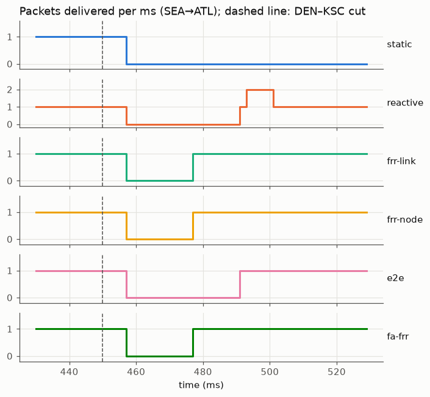
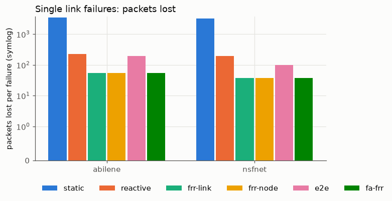
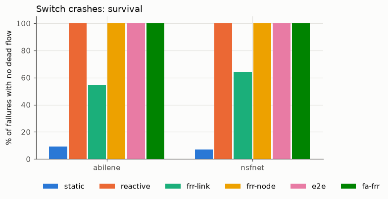
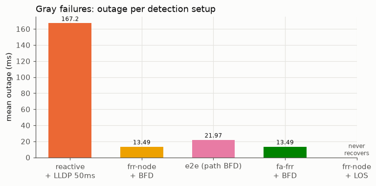
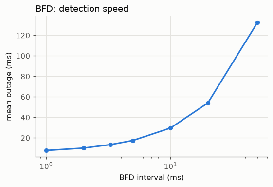
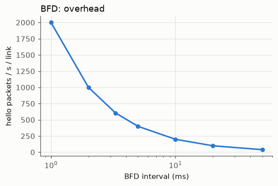
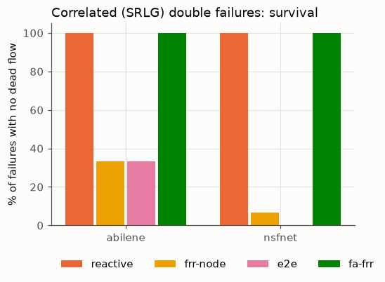
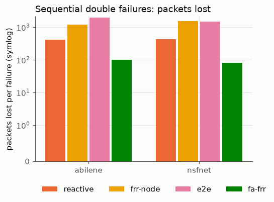
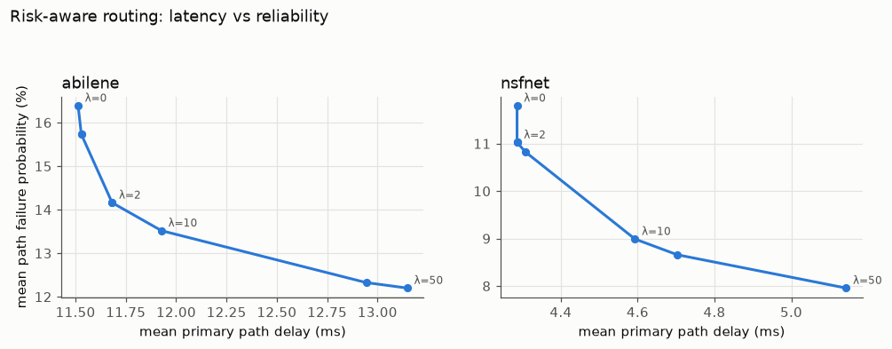

# Evaluation report

Generated by `python -m ffr experiment` in 186 s. Traffic: all host pairs, constant bit rate; outage = longest run of consecutive lost packets. Raw data: the CSV files next to this report.

## What a failure looks like

One flow (SEA→ATL, 1000 pkt/s) crosses DEN–KSC, which is cut at 450 ms. Packets delivered per millisecond, per strategy.

| app | lost | outage_ms | hops_after |
|---|---|---|---|
| static | 262 | inf | 5 |
| reactive | 21 | 21.0 | 5 |
| frr-link | 5 | 5.0 | 6 |
| frr-node | 5 | 5.0 | 6 |
| e2e | 29 | 29.0 | 5 |
| fa-frr | 5 | 5.0 | 5 |

## Single link failures

Every link is cut once (LOS detection). How much traffic does each strategy lose, how long are outages, how good are paths afterwards and what does it cost?

| topo | app | runs | survival_pct | dead_flows | lost_pkts | mean_outage_ms | max_outage_ms | stretch |
|---|---|---|---|---|---|---|---|---|
| abilene | static | 14 | 0.0 | 19.71 | 3533.4 | n/a | n/a | 1.0 |
| abilene | reactive | 14 | 100.0 | 0.0 | 228.1 | 23.2 | 32.0 | 1.027 |
| abilene | frr-link | 14 | 100.0 | 0.0 | 54.5 | 5.93 | 12.0 | 1.162 |
| abilene | frr-node | 14 | 100.0 | 0.0 | 54.5 | 5.93 | 12.0 | 1.17 |
| abilene | e2e | 14 | 100.0 | 0.0 | 198.7 | 18.67 | 56.0 | 1.065 |
| abilene | fa-frr | 14 | 100.0 | 0.0 | 54.5 | 5.93 | 12.0 | 1.027 |
| nsfnet | static | 21 | 0.0 | 18.57 | 3281.7 | n/a | n/a | 1.0 |
| nsfnet | reactive | 21 | 100.0 | 0.0 | 197.7 | 21.18 | 26.0 | 1.0 |
| nsfnet | frr-link | 21 | 100.0 | 0.0 | 37.1 | 4.0 | 4.0 | 1.181 |
| nsfnet | frr-node | 21 | 100.0 | 0.0 | 37.1 | 4.0 | 4.0 | 1.19 |
| nsfnet | e2e | 21 | 100.0 | 0.0 | 98.7 | 10.35 | 20.0 | 1.018 |
| nsfnet | fa-frr | 21 | 100.0 | 0.0 | 37.1 | 4.0 | 4.0 | 1.0 |

## Switch crashes

Each switch crashes once (flows to/from it are excluded). Link protection's detours may run through the crashed switch; node protection's may not.

| topo | app | runs | survival_pct | dead_flows | lost_pkts | mean_outage_ms | max_outage_ms | stretch |
|---|---|---|---|---|---|---|---|---|
| abilene | static | 11 | 9.1 | 15.09 | 2728.3 | 0.0 | 0.0 | 1.0 |
| abilene | reactive | 11 | 100.0 | 0.0 | 206.9 | 25.03 | 36.0 | 1.011 |
| abilene | frr-link | 11 | 54.5 | 4.73 | 906.5 | 9.68 | 18.0 | 1.039 |
| abilene | frr-node | 11 | 100.0 | 0.0 | 74.5 | 9.64 | 18.0 | 1.062 |
| abilene | e2e | 11 | 100.0 | 0.0 | 163.6 | 18.94 | 52.0 | 1.048 |
| abilene | fa-frr | 11 | 100.0 | 0.0 | 74.5 | 9.64 | 18.0 | 1.011 |
| nsfnet | static | 14 | 7.1 | 14.86 | 2634.6 | 0.0 | 0.0 | 1.0 |
| nsfnet | reactive | 14 | 100.0 | 0.0 | 171.3 | 21.2 | 28.0 | 1.0 |
| nsfnet | frr-link | 14 | 64.3 | 1.64 | 330.9 | 5.57 | 6.0 | 1.068 |
| nsfnet | frr-node | 14 | 100.0 | 0.0 | 44.6 | 5.57 | 6.0 | 1.072 |
| nsfnet | e2e | 14 | 100.0 | 0.0 | 71.4 | 8.51 | 18.0 | 1.008 |
| nsfnet | fa-frr | 14 | 100.0 | 0.0 | 44.6 | 5.57 | 6.0 | 1.0 |

## Gray (silent) failures

Links fail silently: the signal stays up but every packet is dropped. Which detection mechanisms notice, and how fast?

| config | runs | survival_pct | dead_flows | lost_pkts | mean_outage_ms | max_outage_ms | stretch |
|---|---|---|---|---|---|---|---|
| reactive + LLDP 50ms | 14 | 100.0 | 0.0 | 1647.6 | 167.2 | 176.0 | 1.027 |
| frr-node + LOS | 14 | 0.0 | 19.71 | 5504.8 | n/a | n/a | 1.0 |
| frr-node + BFD | 14 | 100.0 | 0.0 | 130.8 | 13.49 | 20.0 | 1.17 |
| e2e (path BFD) | 14 | 100.0 | 0.0 | 226.6 | 21.97 | 56.0 | 1.065 |
| fa-frr + BFD | 14 | 100.0 | 0.0 | 130.8 | 13.49 | 20.0 | 1.027 |

## BFD interval trade-off

Gray failures detected by BFD (detect multiplier 3). Shorter intervals detect faster but send more hello packets.

| bfd_interval_ms | detect_time_ms | mean_outage_ms | lost_pkts | bfd_pkts_per_s_per_link | bfd_pkts_per_s_network |
|---|---|---|---|---|---|
| 1 | 3 | 7.7 | 63.5 | 2000 | 28000 |
| 2 | 6 | 10.01 | 83.9 | 1000 | 14000 |
| 3.3 | 9.9 | 13.4 | 116.6 | 606 | 8485 |
| 5 | 15 | 17.47 | 148.8 | 400 | 5600 |
| 10 | 30 | 29.55 | 257.6 | 200 | 2800 |
| 20 | 60 | 54.02 | 464.1 | 100 | 1400 |
| 50 | 150 | 132.36 | 1156.8 | 40 | 560 |

## Correlated (SRLG) double failures

Two links that share a risk group (declared in the topology) fail at the same instant.

| topo | app | runs | survival_pct | dead_flows | lost_pkts | mean_outage_ms | max_outage_ms | stretch |
|---|---|---|---|---|---|---|---|---|
| abilene | reactive | 15 | 100.0 | 0.0 | 483.2 | 24.83 | 36.0 | 1.006 |
| abilene | frr-node | 15 | 33.3 | 13.27 | 2471.2 | 7.11 | 18.0 | 1.14 |
| abilene | e2e | 15 | 33.3 | 6.67 | 1497.0 | 19.97 | 52.0 | 1.041 |
| abilene | fa-frr | 15 | 100.0 | 0.0 | 125.1 | 6.71 | 18.0 | 1.006 |
| nsfnet | reactive | 15 | 100.0 | 0.0 | 371.3 | 22.22 | 28.0 | 1.0 |
| nsfnet | frr-node | 15 | 6.7 | 10.4 | 1890.1 | 4.42 | 6.0 | 1.118 |
| nsfnet | e2e | 15 | 0.0 | 6.13 | 1225.7 | 10.93 | 20.0 | 1.021 |
| nsfnet | fa-frr | 15 | 100.0 | 0.0 | 71.7 | 4.29 | 6.0 | 1.0 |

## Sequential double failures

A second, independent link fails 200 ms after the first. Is the network still protected after the first failure?

| topo | app | runs | survival_pct | dead_flows | lost_pkts | mean_outage_ms | max_outage_ms | stretch |
|---|---|---|---|---|---|---|---|---|
| abilene | reactive | 20 | 100.0 | 0.0 | 418.7 | 23.4 | 32.0 | 1.015 |
| abilene | frr-node | 20 | 25.0 | 6.3 | 1225.0 | 5.86 | 12.0 | 1.153 |
| abilene | e2e | 20 | 15.0 | 9.7 | 2006.7 | 17.81 | 56.0 | 1.043 |
| abilene | fa-frr | 20 | 100.0 | 0.0 | 102.0 | 5.98 | 12.0 | 1.015 |
| nsfnet | reactive | 20 | 100.0 | 0.0 | 431.6 | 21.37 | 28.0 | 1.0 |
| nsfnet | frr-node | 20 | 10.0 | 8.25 | 1533.1 | 4.02 | 10.0 | 1.17 |
| nsfnet | e2e | 20 | 15.0 | 7.5 | 1504.8 | 10.85 | 20.0 | 1.015 |
| nsfnet | fa-frr | 20 | 100.0 | 0.0 | 80.7 | 4.0 | 4.0 | 1.0 |

## Flapping links

A link goes down for 40 ms and up for 40 ms, five times in a row.

| topo | app | runs | survival_pct | dead_flows | lost_pkts | mean_outage_ms | max_outage_ms | stretch |
|---|---|---|---|---|---|---|---|---|
| abilene | reactive | 14 | 100.0 | 0.0 | 1142.4 | 23.21 | 32.0 | 1.028 |
| abilene | frr-node | 14 | 100.0 | 0.0 | 272.5 | 5.93 | 12.0 | 1.028 |
| abilene | fa-frr | 14 | 100.0 | 0.0 | 82.3 | 5.93 | 12.0 | 1.412 |

## State and control overhead

Flow-table entries, group entries, controller messages at set-up, and monitoring packets per second (LOS-only detection; e2e includes its path BFD).

| topo | switches | app | flow_entries | groups | ctrl_msgs | probe_pkts_per_s |
|---|---|---|---|---|---|---|
| ring6 | 6 | static | 36 | 0 | 36 | 0 |
| ring6 | 6 | reactive | 36 | 0 | 36 | 0 |
| ring6 | 6 | frr-link | 132 | 30 | 162 | 0 |
| ring6 | 6 | frr-node | 132 | 30 | 162 | 0 |
| ring6 | 6 | e2e | 156 | 30 | 186 | 18176 |
| ring6 | 6 | fa-frr | 132 | 30 | 174 | 0 |
| grid3x3 | 9 | static | 81 | 0 | 81 | 0 |
| grid3x3 | 9 | reactive | 81 | 0 | 81 | 0 |
| grid3x3 | 9 | frr-link | 225 | 72 | 297 | 0 |
| grid3x3 | 9 | frr-node | 219 | 72 | 291 | 0 |
| grid3x3 | 9 | e2e | 297 | 72 | 369 | 43618 |
| grid3x3 | 9 | fa-frr | 219 | 72 | 309 | 0 |
| abilene | 11 | static | 121 | 0 | 121 | 0 |
| abilene | 11 | reactive | 121 | 0 | 121 | 0 |
| abilene | 11 | frr-link | 440 | 110 | 550 | 0 |
| abilene | 11 | frr-node | 404 | 110 | 514 | 0 |
| abilene | 11 | e2e | 621 | 110 | 731 | 66654 |
| abilene | 11 | fa-frr | 404 | 110 | 536 | 0 |
| nsfnet | 14 | static | 196 | 0 | 196 | 0 |
| nsfnet | 14 | reactive | 196 | 0 | 196 | 0 |
| nsfnet | 14 | frr-link | 662 | 182 | 844 | 0 |
| nsfnet | 14 | frr-node | 593 | 182 | 775 | 0 |
| nsfnet | 14 | e2e | 880 | 182 | 1062 | 110300 |
| nsfnet | 14 | fa-frr | 593 | 182 | 803 | 0 |
| grid4x4 | 16 | static | 256 | 0 | 256 | 0 |
| grid4x4 | 16 | reactive | 256 | 0 | 256 | 0 |
| grid4x4 | 16 | frr-link | 848 | 240 | 1088 | 0 |
| grid4x4 | 16 | frr-node | 816 | 240 | 1056 | 0 |
| grid4x4 | 16 | e2e | 1248 | 240 | 1488 | 145436 |
| grid4x4 | 16 | fa-frr | 816 | 240 | 1088 | 0 |
| grid5x5 | 25 | static | 625 | 0 | 625 | 0 |
| grid5x5 | 25 | reactive | 625 | 0 | 625 | 0 |
| grid5x5 | 25 | frr-link | 2425 | 600 | 3025 | 0 |
| grid5x5 | 25 | frr-node | 2325 | 600 | 2925 | 0 |
| grid5x5 | 25 | e2e | 3825 | 600 | 4425 | 363632 |
| grid5x5 | 25 | fa-frr | 2325 | 600 | 2975 | 0 |

## Risk-aware routing trade-off

Analytic (no simulation): primary paths minimise delay/mean_delay + λ·(−ln(1−p)) with seeded heterogeneous link failure priors (0.5%–15%). Larger λ buys reliability with latency.

| topo | lam | mean_path_delay_ms | mean_path_fail_prob_pct |
|---|---|---|---|
| abilene | 0 | 11.513 | 16.387 |
| abilene | 0.5 | 11.529 | 15.73 |
| abilene | 1 | 11.529 | 15.73 |
| abilene | 2 | 11.682 | 14.16 |
| abilene | 5 | 11.682 | 14.16 |
| abilene | 10 | 11.927 | 13.518 |
| abilene | 20 | 12.944 | 12.326 |
| abilene | 50 | 13.148 | 12.2 |
| nsfnet | 0 | 4.286 | 11.799 |
| nsfnet | 0.5 | 4.286 | 11.025 |
| nsfnet | 1 | 4.286 | 11.025 |
| nsfnet | 2 | 4.286 | 11.025 |
| nsfnet | 5 | 4.308 | 10.823 |
| nsfnet | 10 | 4.593 | 8.989 |
| nsfnet | 20 | 4.703 | 8.658 |
| nsfnet | 50 | 5.143 | 7.956 |

